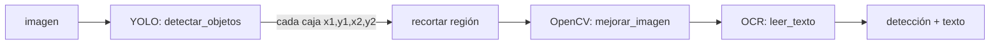

# API de visión por computadora: OCR, OpenCV y YOLO

Backend en Python y FastAPI que recibe una imagen y permite probar tres técnicas por separado y en conjunto:

| Ruta | Qué hace | Respuesta |
|------|----------|-----------|
| `POST /ocr` | Lee el texto con Tesseract | `{"texto": "LA PAZ"}` |
| `POST /opencv` | Pasa a escala de grises y mejora el contraste | Imagen PNG (`image/png`) |
| `POST /yolo` | Detecta objetos con YOLO11n | `{"detecciones": [...]}` |
| `POST /analizar` | YOLO → recorte → OpenCV → OCR | `{"detecciones": [... con "texto"]}` |

Todas reciben un archivo JPEG o PNG por `multipart/form-data` en el campo **`imagen`**.
Si el archivo está vacío o no es una imagen válida, responden **HTTP 400** con un mensaje en `detail`.

## Estructura

```
vision-imagenes-api/
├── app/
│   ├── main.py               # Las 4 rutas HTTP (solo reciben, llaman a servicios y responden)
│   ├── config.py             # Configuración leída de variables de entorno / .env
│   ├── schemas.py            # Modelos Pydantic de las respuestas JSON
│   └── services/
│       ├── imagenes.py       # Bytes → imagen de OpenCV (y validación JPEG/PNG)
│       ├── ocr_service.py    # leer_texto()        → Tesseract
│       ├── opencv_service.py # mejorar_imagen()    → grises + contraste (CLAHE)
│       └── yolo_service.py   # detectar_objetos()  → YOLO, cargado una sola vez
├── ejemplos/
│   ├── crear_imagen_texto.py # Genera texto_la_paz.png
│   └── texto_la_paz.png
├── tests/test_api.py         # Pruebas automáticas de las 4 rutas
├── .env.example
└── requirements.txt
```

`/analizar` no tiene lógica propia de visión: reutiliza `detectar_objetos()`, `mejorar_imagen()` y `leer_texto()`, las mismas funciones que usan `/yolo`, `/opencv` y `/ocr`.



## Requisitos

- Windows 10/11 con Python 3.11 o superior (probado con 3.13).
- Tesseract OCR 5 con el idioma español.
- VS Code (opcional) con la extensión de Python.

## 1. Instalar Tesseract en Windows (con español)

**Opción A: instalador gráfico (recomendada)**

1. Descarga el instalador de UB Mannheim: <https://github.com/UB-Mannheim/tesseract/wiki>.
2. En la pantalla *Choose Components* abre **Additional language data (download)** y marca **Spanish**.
3. Deja la ruta por defecto: `C:\Program Files\Tesseract-OCR`.

**Opción B: winget**

```powershell
winget install --id UB-Mannheim.TesseractOCR -e
```

winget instala solo inglés. Para agregar español, descarga `spa.traineddata` de <https://github.com/tesseract-ocr/tessdata_fast> y cópialo en `C:\Program Files\Tesseract-OCR\tessdata` (requiere permisos de administrador).
Si no tienes permisos de administrador, crea una carpeta `tessdata` dentro del proyecto, copia ahí `eng.traineddata`, `osd.traineddata` y `spa.traineddata`, y en `.env` define `TESSDATA_DIR` con la ruta completa a esa carpeta.

Comprueba la instalación:

```powershell
& "C:\Program Files\Tesseract-OCR\tesseract.exe" --list-langs
```

Debe aparecer `spa` en la lista.

**¿Tesseract no está en el PATH?** No hace falta agregarlo: la API lo busca primero en el `PATH` y luego en `C:\Program Files\Tesseract-OCR\tesseract.exe`. Si lo instalaste en otra carpeta, define `TESSERACT_CMD` en `.env`:

```
TESSERACT_CMD=D:\Programas\Tesseract-OCR\tesseract.exe
```

## 2. Crear el entorno virtual e instalar dependencias

En la terminal de VS Code (PowerShell), dentro de la carpeta del proyecto:

```powershell
python -m venv .venv
.\.venv\Scripts\Activate.ps1
python -m pip install --upgrade pip
pip install -r requirements.txt
copy .env.example .env
```

Si PowerShell bloquea `Activate.ps1`, ejecuta una vez `Set-ExecutionPolicy -Scope CurrentUser RemoteSigned`.
En VS Code, elige el intérprete con *Ctrl+Shift+P → Python: Select Interpreter → .venv*.

## 3. Arrancar la API

```powershell
python -m uvicorn app.main:app --reload
```

Abre <http://127.0.0.1:8000/docs> para ver Swagger.

## 4. Probar las rutas en Swagger (`/docs`)

Para cada ruta: despliégala, pulsa **Try it out**, en `imagen` pulsa **Seleccionar archivo**, elige una imagen y pulsa **Execute**.

| Ruta | Qué esperar |
|------|-------------|
| `/ocr` | `{"texto": "..."}`; con una imagen sin texto, `{"texto": ""}` |
| `/opencv` | Swagger muestra la imagen en grises con más contraste; puedes descargarla con *Download file* |
| `/yolo` | Lista de `detecciones` con `objeto`, `confianza` y `coordenadas` `[x1, y1, x2, y2]` |
| `/analizar` | Las mismas detecciones con un campo `texto` cada una; `{"detecciones": []}` si no hay objetos |

La **primera** llamada a `/yolo` o `/analizar` tarda más: descarga los pesos (si no existen) y carga el modelo. Las siguientes reutilizan el modelo ya cargado.

### Ejemplo manual 1: OCR con texto grande

1. Genera la imagen de ejemplo (ya viene incluida):
   ```powershell
   python ejemplos/crear_imagen_texto.py
   ```
2. En `/docs`, abre `POST /ocr` y sube `ejemplos/texto_la_paz.png`.
3. Respuesta esperada:
   ```json
   {"texto": "LA PAZ"}
   ```
4. Sube la misma imagen a `POST /opencv` para ver la versión en grises.

También sirve una foto propia de un cartel o una hoja con letras grandes, de frente y bien iluminada.

### Ejemplo manual 2: flujo combinado con un bus

1. Usa una foto de un bus en la que el letrero se lea bien (de frente o de lado, sin desenfoque).
   Si no tienes una, Ultralytics incluye una foto de un bus de Madrid:
   ```powershell
   explorer .venv\Lib\site-packages\ultralytics\assets
   ```
   (archivo `bus.jpg`).
2. En `/docs`, prueba primero `POST /yolo` para ver las cajas detectadas.
3. Luego sube la misma foto a `POST /analizar`. Con `bus.jpg` se obtiene algo como:
   ```json
   {
     "detecciones": [
       {"objeto": "bus", "confianza": 0.94, "coordenadas": [4, 229, 796, 728], "texto": "... MADRID ..."},
       {"objeto": "person", "confianza": 0.89, "coordenadas": [671, 395, 810, 879], "texto": "..."}
     ]
   }
   ```
   Con una foto de un bus con un letrero «LA PAZ», el campo `texto` del bus debería contener `LA PAZ`.

> El OCR lee **toda** la región del objeto, por eso en fotos reales aparecen caracteres sueltos además del letrero. Funciona mejor cuando el letrero ocupa buena parte de la caja detectada.

### Probar desde la terminal (opcional)

```powershell
curl.exe -F "imagen=@ejemplos/texto_la_paz.png" http://127.0.0.1:8000/ocr
curl.exe -F "imagen=@ejemplos/texto_la_paz.png" http://127.0.0.1:8000/opencv -o procesada.png
curl.exe -F "imagen=@.venv/Lib/site-packages/ultralytics/assets/bus.jpg" http://127.0.0.1:8000/yolo
curl.exe -F "imagen=@.venv/Lib/site-packages/ultralytics/assets/bus.jpg" http://127.0.0.1:8000/analizar
```

### Pruebas automáticas

```powershell
python -m pytest -v
```

Cubren las 4 rutas, imágenes vacías o inválidas (400), imágenes sin texto y sin objetos.

## YOLO: pesos, CPU y GPU

### De dónde salen los pesos

Se usa **YOLO11n** (`yolo11n.pt`, ~5,4 MB), la versión más liviana de Ultralytics, preentrenada con el conjunto COCO (80 clases: `person`, `car`, `bus`, `truck`, etc.).
La primera vez que se usa, Ultralytics la descarga automáticamente desde sus *releases* de GitHub (<https://github.com/ultralytics/assets/releases>) y la guarda en `modelos/yolo11n.pt`. También puedes descargarla a mano y dejarla en esa carpeta.
Documentación del modelo: <https://docs.ultralytics.com/models/yolo11/>.

Para usar otro modelo (por ejemplo `yolo11s.pt`, más preciso y más lento), cambia `YOLO_MODELO` en `.env`.

### CPU por defecto

`YOLO_DISPOSITIVO=cpu` está configurado por defecto. El `pip install` normal en Windows instala PyTorch **solo para CPU**.

### Usar la GPU (NVIDIA)

1. Instala PyTorch con CUDA (elige el comando en <https://pytorch.org/get-started/locally/>), por ejemplo:
   ```powershell
   pip install torch torchvision --index-url https://download.pytorch.org/whl/cu128 --force-reinstall
   ```
2. Comprueba que PyTorch ve la GPU:
   ```powershell
   python -c "import torch; print(torch.cuda.is_available(), torch.cuda.get_device_name(0))"
   ```
   Debe mostrar `True` y el nombre de tu tarjeta.
3. En `.env` cambia:
   ```
   YOLO_DISPOSITIVO=0
   ```
   (`0` o `cuda:0` es la primera GPU). Reinicia uvicorn.

Si pides la GPU pero PyTorch no tiene CUDA, la API muestra una advertencia en la consola y usa la CPU.

## Configuración (`.env`)

| Variable | Por defecto | Para qué sirve |
|----------|-------------|----------------|
| `TESSERACT_CMD` | (auto) | Ruta a `tesseract.exe` si no está en el `PATH` |
| `TESSDATA_DIR` | (instalación) | Carpeta con los archivos `*.traineddata` |
| `TESSERACT_IDIOMA` | `spa+eng` | Idiomas del OCR |
| `TESSERACT_PSM` | `11` | Modo de página: `11` texto disperso (fotos), `6` un bloque de texto, `7` una sola línea |
| `YOLO_MODELO` | `modelos/yolo11n.pt` | Pesos del modelo |
| `YOLO_DISPOSITIVO` | `cpu` | `cpu`, `0` o `cuda:0` |
| `YOLO_CONFIANZA_MINIMA` | `0.25` | Descarta detecciones con menos confianza |

## Errores comunes

| Mensaje | Solución |
|---------|----------|
| 400 `El archivo está vacío...` | Selecciona un archivo en el campo `imagen` |
| 400 `El archivo no es una imagen JPEG o PNG.` | Convierte la imagen a JPG o PNG |
| 503 `No se encontró Tesseract...` | Instala Tesseract o define `TESSERACT_CMD` |
| 503 `Tesseract falló... idiomas 'spa+eng'` | Falta `spa.traineddata`; ver sección 1 |
